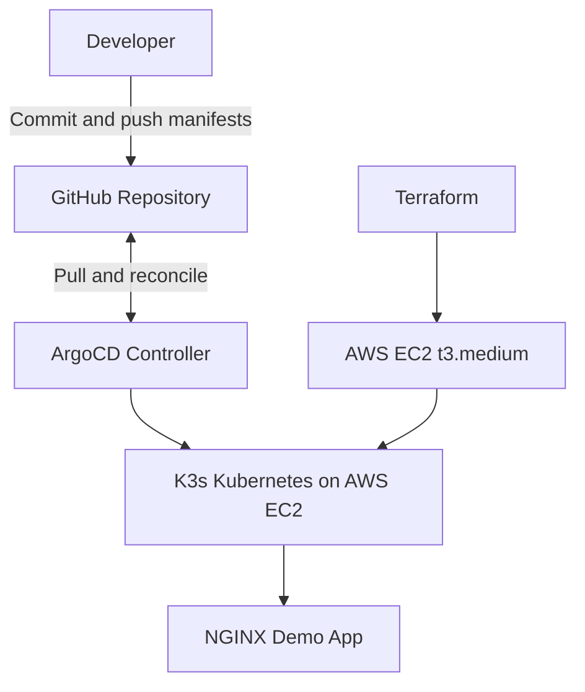

# GitOps Workflow using ArgoCD on Kubernetes

A self-contained portfolio project using Terraform, AWS EC2, K3s, Kubernetes, ArgoCD and GitHub.

## Architecture

- AWS region: `ap-south-1` (Mumbai)
- EC2: `t3.medium`
- OS: Ubuntu 22.04 LTS
- Root disk: 15 GiB encrypted GP3
- Kubernetes: K3s
- GitOps controller: ArgoCD
- Demo workload: Nginx
- No EKS, NAT Gateway or Load Balancer

## Folder structure

```text
gitops-argocd-terraform/
├── terraform/
│   ├── main.tf
│   ├── variables.tf
│   ├── outputs.tf
│   └── user_data.sh
├── k8s-manifests/
│   ├── namespace.yaml
│   ├── deployment.yaml
│   └── service.yaml
├── argocd/
│   └── application.yaml
├── scripts/
│   └── verify-setup.sh
└── README.md
```

## Prerequisites

Install Terraform, Git and an SSH client. In AWS, create an EC2 key pair. Configure AWS credentials locally using an AWS CLI profile or environment credentials with permissions to create EC2, security groups and related resources.

## 1. Create GitHub repository

Create a public repository named `gitops-argocd-terraform` on GitHub. Do not add a separate README if pushing this folder as-is.

## 2. Update the ArgoCD repository URL

Before deploying the ArgoCD Application, edit `argocd/application.yaml` and replace **`<YOUR_GITHUB_USERNAME>`** with your GitHub username. Ensure the repository URL is:

`https://github.com/YOUR_ACTUAL_USERNAME/gitops-argocd-terraform.git`

## 3. Push the project to GitHub

From this project root:

```bash
git init
git add .
git commit -m "Initial GitOps ArgoCD project"
git branch -M main
git remote add origin https://github.com/YOUR_GITHUB_USERNAME/gitops-argocd-terraform.git
git push -u origin main
```

Replace `YOUR_GITHUB_USERNAME` in the commands as well.

## 4. Configure Terraform variables

```bash
cd terraform
```

Create `terraform.tfvars` (this file is intentionally not included in the project archive):

```hcl
aws_region       = "ap-south-1"
instance_type    = "t3.medium"
key_name         = "YOUR_EXISTING_KEY_PAIR_NAME"
allowed_ssh_cidr = "YOUR_PUBLIC_IPV4/32"
```

Use your public IPv4 address with `/32` to restrict SSH. The key pair must already exist in the selected AWS region.

## 5. Deploy

```bash
terraform init
terraform validate
terraform plan
terraform apply
```

Review the plan and type `yes` to approve.

Terraform provisions the EC2 instance and security group. EC2 user-data installs K3s and ArgoCD; bootstrap can take several minutes beyond Terraform's completion.

## 6. Read outputs

```bash
terraform output
terraform output ec2_public_ip
terraform output argocd_ui_url
terraform output sample_app_url
```

## 7. SSH to EC2

```bash
ssh -i YOUR_PRIVATE_KEY.pem ubuntu@YOUR_EC2_PUBLIC_IP
```

## 8. Verify K3s and ArgoCD bootstrap

On EC2:

```bash
sudo kubectl get nodes
sudo kubectl get pods -A
sudo kubectl get pods -n argocd
sudo kubectl get svc -n argocd
sudo tail -n 100 /var/log/user-data.log
```

## 9. Fetch initial ArgoCD password

On EC2:

```bash
sudo kubectl get secret argocd-initial-admin-secret -n argocd -o jsonpath="{.data.password}" | base64 -d
echo
```

Username is `admin`. The secret may be removed after changing the initial password.

The helper script can also check the node and ArgoCD readiness and fetch the password:

```bash
# From the project root on EC2, after transferring this repository:
chmod +x scripts/verify-setup.sh
sudo ./scripts/verify-setup.sh
```

## 10. Access ArgoCD UI

Open the output URL or:

`https://YOUR_EC2_PUBLIC_IP:30443`

The initial demo installation may use a self-signed TLS certificate, so the browser may display a certificate warning.

## 11. Apply the ArgoCD Application

Copy the manifest to EC2 from your local computer:

```bash
scp -i YOUR_PRIVATE_KEY.pem argocd/application.yaml ubuntu@YOUR_EC2_PUBLIC_IP:/home/ubuntu/application.yaml
```

On EC2:

```bash
sudo kubectl apply -f /home/ubuntu/application.yaml
sudo kubectl get applications -n argocd
sudo kubectl get pods -n demo-app
```

ArgoCD follows the `k8s-manifests` path in GitHub and automatically synchronizes the resources.

## 12. Verify synchronization and health

```bash
sudo kubectl get application gitops-demo -n argocd
sudo kubectl get deployment -n demo-app
sudo kubectl get pods -n demo-app
sudo kubectl get svc -n demo-app
```

ArgoCD UI should report the application as **Synced** and **Healthy** once reconciliation and health checks complete.

## 13. Verify application endpoint

Open:

`http://YOUR_EC2_PUBLIC_IP:30080`

The Nginx application should respond.

## 14. GitOps v2 update test: scale to three replicas

Edit `k8s-manifests/deployment.yaml` locally and change:

```yaml
replicas: 2
```

to:

```yaml
replicas: 3
```

Commit and push:

```bash
git add k8s-manifests/deployment.yaml
git commit -m "Scale demo to three replicas"
git push origin main
```

Watch reconciliation on EC2:

```bash
sudo kubectl get pods -n demo-app -w
```

Verify the desired replica count:

```bash
sudo kubectl get deployment gitops-demo -n demo-app
sudo kubectl get application gitops-demo -n argocd
```

ArgoCD should automatically synchronize the change after its repository refresh, and the app should converge to three replicas.

## 15. Self-healing test

ArgoCD is configured with `selfHeal: true`. Temporarily scale the workload manually:

```bash
sudo kubectl scale deployment gitops-demo -n demo-app --replicas=1
```

ArgoCD should detect drift and restore the repository-defined replica count.

## 16. Security group

Inbound rules:

| Port | Purpose |
|---|---|
| 22 | SSH, restricted to the configured CIDR |
| 80 | HTTP |
| 30080 | Sample application NodePort |
| 30443 | ArgoCD UI NodePort |

SSH is restricted to your configured IP CIDR. The other listed ports are open to IPv4 internet traffic in this demo.

## 17. Cost-Saving Cleanup

**After taking screenshots and completing your tests, immediately destroy the AWS resources to avoid ongoing charges.**

From the Terraform directory:

```bash
terraform destroy -auto-approve
```

Confirm the EC2 instance and security group are removed in the AWS Console. The root EBS volume is configured to delete on termination.

## Skills demonstrated

- Infrastructure as Code using Terraform
- AWS EC2 provisioning
- K3s Kubernetes installation
- ArgoCD GitOps workflows
- Automated sync and self-healing
- GitHub-based desired state management
- Kubernetes deployment and NodePort services
- Infrastructure teardown and cost management

## Architecture Diagram



## Screenshots & Demo Proof

The five required screenshots are documented in the [`screenshots/`](screenshots/) folder. Capture the actual deployment evidence and save the files there using the names listed in [`screenshots/README.md`](screenshots/README.md).

## Resume Highlight

> Implemented GitOps pipeline using ArgoCD and Kubernetes provisioned via Terraform on AWS

## Project Deliverables

- [Project Report](docs/Project_Report.md)
- [GitOps Workflow Notes](docs/GitOps_Workflow_Notes.md)
- [Screenshot checklist](screenshots/README.md)
