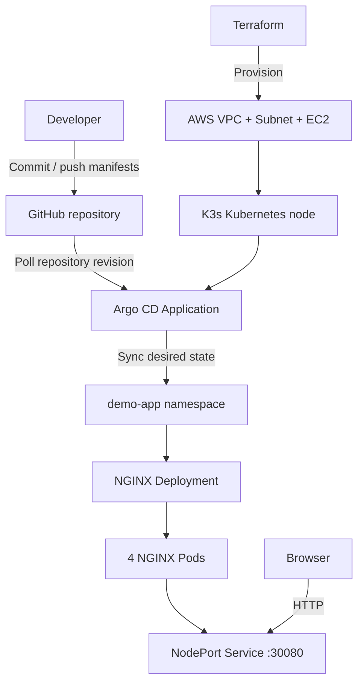

# GitOps Delivery on Kubernetes with Argo CD & Terraform

> **Internship Project 10 · DevOps Engineering · AWS (ap-south-1)**  
> A hands-on GitOps demonstration that provisions a Kubernetes host on AWS with Terraform and uses Argo CD to reconcile an NGINX workload from GitHub.

[](https://developer.hashicorp.com/terraform)
[](https://kubernetes.io/)
[](https://argo-cd.readthedocs.io/)
[](https://aws.amazon.com/)

## Project at a glance

This repository demonstrates the GitOps operating model: **Git stores the desired application state; Argo CD continuously compares that state with the Kubernetes cluster and reconciles differences.**

Terraform creates a dedicated AWS VPC, public subnet, Internet Gateway, routing, security group and EC2 instance. The instance bootstraps Ubuntu, K3s and Argo CD. An Argo CD `Application` watches `k8s-manifests/` in this repository and deploys a small NGINX workload into Kubernetes.

| Item | Implementation |
|---|---|
| Internship alignment | Project 10 — GitOps Workflow using ArgoCD on Kubernetes |
| Cloud | AWS, `ap-south-1` (Mumbai) |
| Infrastructure | Terraform-managed VPC and EC2 |
| Kubernetes | Single-node K3s cluster |
| GitOps controller | Argo CD |
| Workload | NGINX Deployment (4 desired replicas) |
| Exposure | Kubernetes NodePort `30080` |
| Git source | This GitHub repository, `main` / `HEAD` |

**Scope note:** This is an educational single-node lab, not a highly available production platform. The sample workload is the standard NGINX welcome page; the project demonstrates infrastructure provisioning and GitOps reconciliation rather than application feature development.

## Architecture



### Reconciliation flow

1. A developer changes a Kubernetes manifest and pushes the commit to GitHub.
2. Argo CD checks the configured repository and `k8s-manifests/` path.
3. Argo CD detects that the Git desired state differs from the live cluster.
4. Automated sync applies the declared state. `selfHeal` corrects supported live drift; `prune` removes managed resources deleted from Git.
5. The Kubernetes Deployment controller creates or replaces pods to match the declared replica count.

## Repository map

```text
.
├── argocd/
│   └── application.yaml          # Argo CD Application source and sync policy
├── docs/
│   ├── ARCHITECTURE.md           # Design and component responsibilities
│   ├── DEMO_GUIDE.md             # Guided demo and verification commands
│   ├── GitOps_Workflow_Notes.md  # GitOps concepts used in this lab
│   ├── Project_Report.md         # Editable internship report source
│   └── SECURITY.md              # Access and operational cautions
├── k8s-manifests/
│   ├── namespace.yaml
│   ├── deployment.yaml           # NGINX Deployment, probes and resources
│   └── service.yaml              # NodePort 30080
├── screenshots/                  # Original execution evidence
├── scripts/
│   └── verify-setup.sh            # Read-only cluster checks
└── terraform/
    ├── main.tf                   # AWS network and EC2 resources
    ├── variables.tf
    ├── outputs.tf
    └── user_data.sh               # K3s and Argo CD bootstrap
```

## Technology stack

- **AWS VPC, EC2, subnet, Internet Gateway and route table** — isolated lab network and compute.
- **Terraform** — repeatable infrastructure as code.
- **Ubuntu 22.04 LTS + K3s** — lightweight Kubernetes runtime on one EC2 instance.
- **Argo CD** — declarative continuous delivery and reconciliation.
- **Kubernetes Deployment, Service and Namespace** — workload lifecycle and networking.
- **GitHub** — versioned desired state and change history.
- **NGINX** — simple HTTP workload used to validate deployment.

## Prerequisites

- AWS account with permission to create and delete the resources defined in `terraform/`.
- Terraform `>= 1.5.0`, AWS CLI and an AWS credential profile configured locally.
- An existing EC2 key pair only if SSH access is required.
- Your public IPv4 address in CIDR notation (for example `203.0.113.10/32`) for the SSH and Argo CD administrative access rule.
- Git installed locally.

Do not commit AWS credentials, private keys, Terraform state, or `.tfvars` files.

## Deploy the lab

> **Cost warning:** EC2, EBS and other AWS resources may incur charges. The default instance type is `t3.medium`. Review the AWS pricing for your account and region before applying. Destroy the lab when finished.

```bash
git clone https://github.com/Jafar19Khan/gitops-argocd-terraform.git
cd gitops-argocd-terraform/terraform
cp terraform.tfvars.example terraform.tfvars
```

Edit `terraform.tfvars` with your own values:

```hcl
aws_region       = "ap-south-1"
instance_type    = "t3.medium"
key_name         = ""                 # Optional; set an existing EC2 key pair to use SSH
allowed_ssh_cidr = "YOUR_PUBLIC_IP/32"
```

Then provision:

```bash
terraform init
terraform fmt -recursive
terraform validate
terraform plan
terraform apply
```

Terraform outputs the EC2 public IP, Argo CD URL and sample application URL. Bootstrap takes several minutes after EC2 becomes available; wait for K3s and Argo CD to finish installing before opening the interfaces.

### Register the GitOps application

Connect to the EC2 host (if using a key pair) and apply the Argo CD Application once:

```bash
kubectl apply -f argocd/application.yaml
```

If the repository is public, Argo CD can read it without repository credentials. For a private repository, configure repository credentials securely in Argo CD; never put a token in a committed manifest.

### Verify

On the EC2 host:

```bash
sudo kubectl get nodes -o wide
sudo kubectl get pods -n argocd
sudo kubectl get all -n demo-app
sudo kubectl get application gitops-demo -n argocd
```

Or run the helper:

```bash
bash scripts/verify-setup.sh
```

Open the application URL from Terraform outputs. The Argo CD interface is available on HTTPS port `30443`; access is restricted by the configured administrative CIDR.

## Demonstrate GitOps

1. Open `k8s-manifests/deployment.yaml`.
2. Change `spec.replicas` from `4` to `3` (or another test value).
3. Commit and push the change to the branch tracked by Argo CD.
4. Watch the Argo CD application move from `OutOfSync` to `Synced`.
5. Verify the live Deployment and pods with `kubectl get deployment,pods -n demo-app`.
6. Optionally test self-healing by changing a managed field directly in the cluster, then observe Argo CD reconcile it back to Git. Restore the Git-defined value after the demonstration.

**Important:** Do not claim that Argo CD builds container images. In this repository it deploys Kubernetes manifests; image build and publication are outside this project's scope.

## Evidence

The `screenshots/` directory contains the original project execution evidence:

| Evidence | What it demonstrates |
|---|---|
| `01-terraform-apply.png` | Terraform apply completion and output endpoints |
| `02-k3s-argocd-pods.png` | K3s node and Argo CD / workload pod status |
| `03-argocd-synced-healthy.png` | Argo CD application showing Synced and Healthy |
| `04-live-app-browser.png` | NGINX welcome page served through NodePort |
| `05-terraform-destroy.png` | Terraform destroy completion |

These are execution screenshots from the supplied project archive. They are retained as evidence and have not been fabricated or replaced.

## Documentation

- [Architecture and component design](docs/ARCHITECTURE.md)
- [Demo and verification guide](docs/DEMO_GUIDE.md)
- [GitOps workflow notes](docs/GitOps_Workflow_Notes.md)
- [Security notes](docs/SECURITY.md)
- [Internship project report (PDF)](docs/DevOps_Internship_Project_Report.pdf)
- [Editable report source](docs/Project_Report.md)

## Learning outcomes

- Provisioning AWS infrastructure with Terraform.
- Bootstrapping a lightweight Kubernetes cluster.
- Defining Kubernetes workloads declaratively.
- Connecting Argo CD to a Git repository.
- Understanding automated sync, self-healing and pruning.
- Verifying application health and cleaning up cloud resources.

## Resume-ready project description

**GitOps Delivery Pipeline with Argo CD, Kubernetes and Terraform** — Provisioned AWS networking and EC2 infrastructure using Terraform, bootstrapped a single-node K3s cluster, and configured Argo CD to continuously synchronize Kubernetes manifests from GitHub. Demonstrated automated deployment reconciliation, self-healing configuration and resource cleanup.

## Author

**Jafar Ali Khan**  
GitHub: [@Jafar19Khan](https://github.com/Jafar19Khan)

---

If you find this project useful, feel free to explore the manifests and workflow notes. For questions or feedback, open a GitHub issue.
